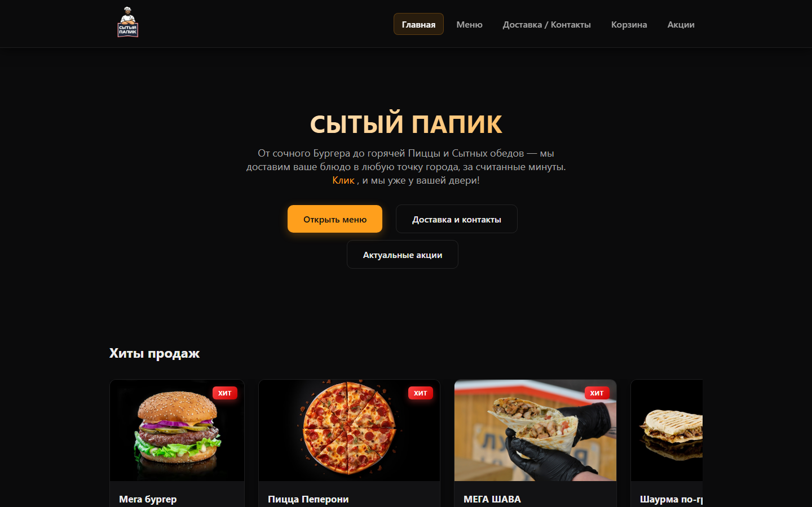
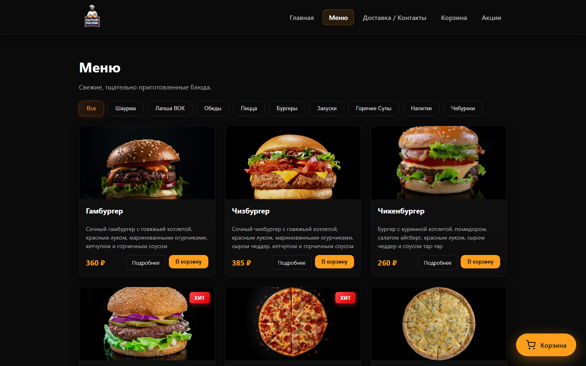
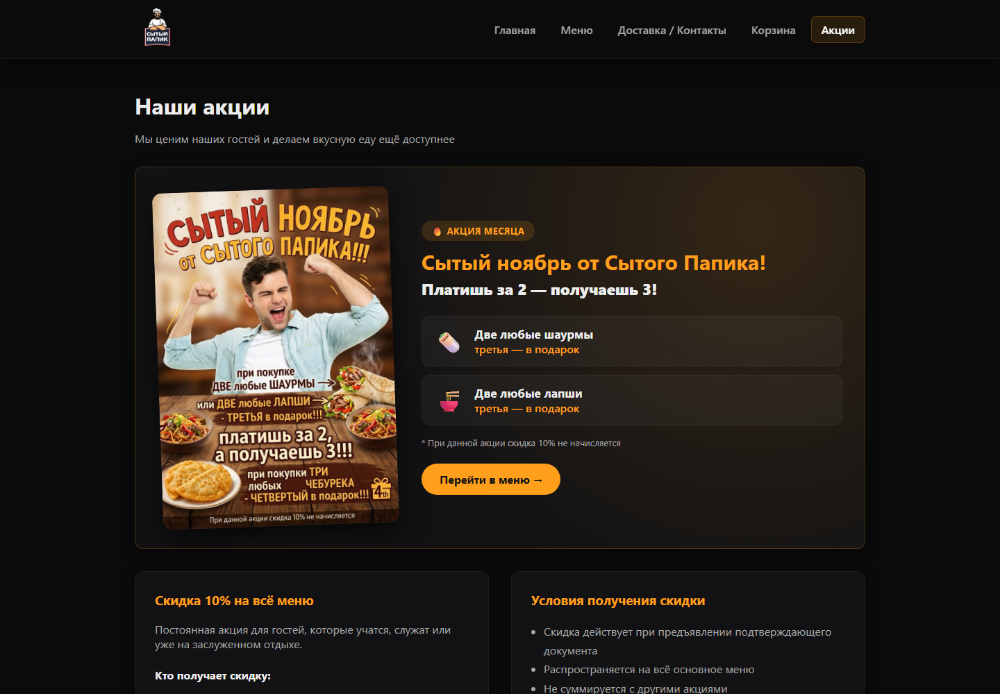

<div align="center">


# Сытый Папик — сайт службы доставки еды

Многостраничный адаптивный сайт для реального кафе фастфуда в Мариуполе:
меню с фильтрацией по категориям, корзина, карточки товаров, акции и интерактивная карта.

[](https://constqqq.github.io/SitiyWeb/)


</div>

---

## Скриншоты

<table>
  <tr>
    <td colspan="2"></td>
  </tr>
  <tr>
    <td width="50%"></td>
    <td width="50%"></td>
  </tr>
  <tr>
    <td align="center"><b>Меню с фильтрацией</b></td>
    <td align="center"><b>Страница акций</b></td>
  </tr>
</table>

## Возможности

- **Динамическое меню.** Больше 30 позиций в 9 категориях (шаурма, WOK, пицца, бургеры, супы и др.), карточки рендерятся из JS‑данных, есть фильтр по категориям и видео‑превью блюд.
- **Корзина без бэкенда.** Состояние хранится в `localStorage`: добавление и удаление, изменение количества, подсчёт суммы, плавающая кнопка корзины со счётчиком.
- **Умные допродажи.** Модальные окна выбора размера, добавок, соусов и напитков к заказу.
- **Страница товара.** Один шаблон `product.html?id=…` для любого блюда, с обработкой 404.
- **Блок «Хиты продаж»** на главной с горизонтальной прокруткой.
- **Акции.** Промо‑баннер с лайтбоксом и условия скидок.
- **Яндекс.Карты** с кастомной тёмной темой на странице доставки.
- **Адаптивная вёрстка.** Mobile‑first, бургер‑меню, корректная работа на iOS (safe‑area).
- **Мелкие UX‑детали.** Копирование телефона в один клик с тостом, копирование готового заказа для звонка, hover‑анимации.

## Стек

| Что | Чем |
|---|---|
| Разметка | Семантический HTML5 |
| Стили | CSS3: Flexbox, Grid, custom properties, media queries, анимации |
| Логика | Vanilla JavaScript (ES6+), DOM API, `localStorage`, Clipboard API |
| Интеграции | Yandex Maps JS API 2.1 |

Проект сознательно сделан **без фреймворков и сборщиков**, чтобы показать владение базой веб‑платформы.

## Структура

```
SitiyWeb/
├── index.html          # Главная: hero, хиты продаж, преимущества, отзывы
├── menu.html           # Меню с фильтром по категориям
├── product.html        # Шаблон карточки товара (?id=)
├── cart.html           # Корзина и оформление заказа
├── delivery.html       # Доставка, контакты, карта
├── promotions.html     # Акции
├── css/                # Стили по модулям (корзина, соусы, напитки, отзывы…)
├── js/
│   ├── menu-cards.js   # Данные меню, рендер, корзина, модалки допродаж
│   ├── cart.js         # Работа с localStorage
│   ├── script.js       # Бургер‑меню и общие скрипты
│   ├── phoneCopy.js    # Копирование номера телефона
│   └── yandexMaps.js   # Инициализация карты с тёмной темой
├── images/  videos/    # Медиа
└── docs/screenshots/   # Скриншоты для README
```

## Запуск локально

```bash
git clone https://github.com/Constqqq/SitiyWeb.git
cd SitiyWeb
# достаточно открыть index.html в браузере
# или поднять локальный сервер:
npx serve .
```

## Автор

**Constqqq** · [GitHub](https://github.com/Constqqq) · constqqq@gmail.com

<div align="center">
<sub>Сделано с большим аппетитом</sub>
</div>
